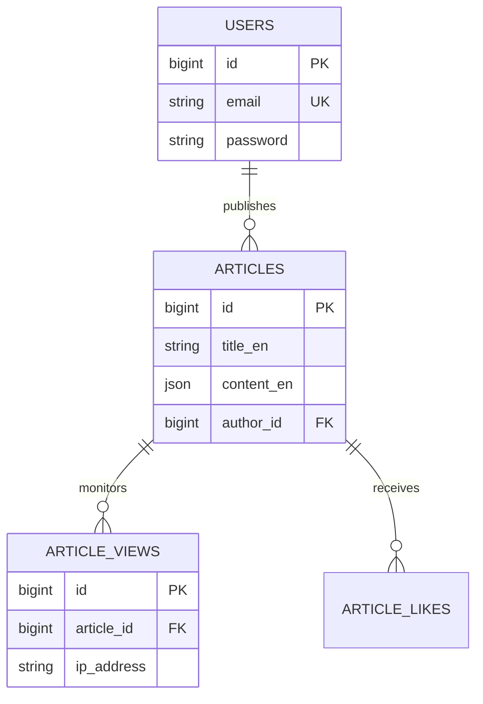
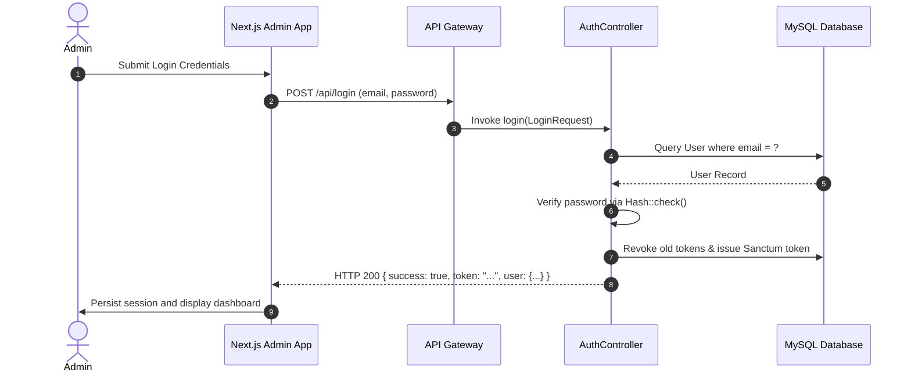

# Ultimate Developer Onboarding & Master Engineering Guide

**Project**: DevFolio Ultimate Portfolio & CMS Engine  
**Backend Framework**: Laravel 11  
**Frontend Framework**: Next.js (TypeScript)  
**Target Audience**: Senior Engineers, Team Leads, & Onboarding Backend Developers  
**Document Status**: Official Internal Team Engineering Handbook  

---

## Table of Contents
1. [Feature-by-Feature Deep Dives](#1-feature-by-feature-deep-dives)
2. [Controllers Step-by-Step & Line-by-Line Rationale](#2-controllers-step-by-step--line-by-line-rationale)
3. [Models Deep Dive](#3-models-deep-dive)
4. [Migrations & Database Schema Rationale](#4-migrations--database-schema-rationale)
5. [API Endpoints Catalog](#5-api-endpoints-catalog)
6. [Architectural Flow Diagrams (Mermaid)](#6-architectural-flow-diagrams-mermaid)
7. [How to Explain This Project in a Job Interview](#7-how-to-explain-this-project-in-a-job-interview)
8. [100 Technical Interview Questions & Detailed Answers](#8-100-technical-interview-questions--detailed-answers)
9. [Project Learning Roadmap](#9-project-learning-roadmap)

---

## 1. Feature-by-Feature Deep Dives

### Feature 1: Authentication & Admin Session Management

#### Why This Feature Exists
The application requires a secure administrative gateway to ensure that only the authenticated portfolio owner can modify personal bio data, post articles, upload private credentials/CVs, and manage projects.

#### Business Requirements
- Provide secure credential verification via email and password.
- Issue stateless API bearer tokens for Next.js frontend client communication.
- Support single-session token revocation on explicit admin logout.
- Prevent unauthorized access to administrative CRUD endpoints with zero token leakage.

#### User Journey & Flow Lifecycle
1. **Frontend Flow**: Admin visits `/admin/login`, inputs email/password credentials, and submits the form. Next.js dispatches a `POST` request to `/api/login`. Upon HTTP 200 response, `localStorage.setItem('admin_token', token)` persists the session and redirects the browser to `/admin/profile`.
2. **Backend Flow**: Request hits Sanctum authentication middleware -> Routed to `AuthController@login` -> Validates email and password using `Hash::check()` -> Revokes existing active tokens -> Generates new token -> Returns `UserResource` wrapped in unified `ApiResponse`.
3. **Database Flow**: Queries `users` table where `email = ?`. Deletes rows in `personal_access_tokens` matching `tokenable_id`. Inserts new hashed token into `personal_access_tokens`.

#### Files Involved
- Controller: `app/Http/Controllers/AuthController.php`
- Requests: `app/Http/Requests/LoginRequest.php`, `RegisterRequest.php`
- Resource: `app/Http/Resources/UserResource.php`
- Model: `app/Models/User.php`
- Routes: `routes/api.php`

#### Edge Cases, Bugs & Common Mistakes
- *Token Expiry*: By default, Sanctum tokens do not expire. We configured `SESSION_LIFETIME` and Sanctum expiration settings to support smooth extended admin sessions without premature 401 logouts during content editing.
- *Common Mistake*: Returning the raw `$user` model from `/api/user` leaks internal database columns like `remember_token` or password hashes if unhidden. Always wrap return values in `UserResource`.

#### How to Extend It
To implement Multi-Factor Authentication (MFA), add a dynamic 6-digit OTP check inside `AuthController@login` before issuing the Sanctum token, or integrate Google Authenticator TOTP packages.

---

### Feature 2: Articles & Technical Blog (Bilingual & Rich Media)

#### Why This Feature Exists
Technical leadership requires demonstrating domain expertise. The Articles module allows the owner to publish long-form technical blogs, deep dives, and tutorials with code blocks, video demonstrations, image galleries, and multi-language support (English and Arabic).

#### Business Requirements
- Support primary content creation in English, with optional translation linking for Arabic.
- Automatically associate uploaded media and code blocks across languages by index position to prevent content desynchronization.
- Track view analytics uniquely per IP address.
- Provide real-time toggle liking without forcing readers to register accounts.

#### Workflow & Architecture
```
[Client App] ──> Accept-Language Header ──> [ArticleController]
                                                  │
                 ┌────────────────────────────────┴────────────────┐
                 ▼                                                 ▼
        Locale == 'ar' ?                                  Locale == 'en' ?
  Return title_ar, content_ar                      Return title_en, content_en
  (Fallback to EN if missing)                      (Default primary strings)
```

#### Files Involved
- Controller: `app/Http/Controllers/ArticleController.php`
- Models: `app/Models/Article.php`, `ArticleLike.php`, `ArticleView.php`
- Resource: `app/Http/Resources/ArticleResource.php`
- Storage: `storage/app/public/articles/`

---

## 2. Controllers Step-by-Step & Line-by-Line Rationale

### `ArticleController.php` Walkthrough

```php
public function store(Request $request)
{
    // Step 1: Validate incoming multipart payload fields
    $request->validate([
        'title_en' => 'required|string|max:255',
        'excerpt_en' => 'required|string',
        // ...
    ]);
```
- **Rationale**: Ensures structural validity before attempting storage. `title_en` and `excerpt_en` are strictly required as baseline content.

```php
    // Step 2: Store main feature image & video files on public disk
    $featureImagePath = $request->hasFile('feature_image')
        ? $request->file('feature_image')->store('articles/images', 'public')
        : null;
```
- **Rationale**: Separates article thumbnail media into organized storage directories (`storage/app/public/articles/images`).

```php
    // Step 3: Iterate content blocks and map code snippets, images, and videos
    $contentEn = [];
    $blocks = $request->input('blocks', []);
    foreach ($blocks as $i => $blockInput) {
        // ... uploads block media dynamically
    }
```
- **Rationale**: Dynamic block structures allow rich modular article layout creation (mixing headings, paragraphs, code syntax blocks, and image carousels).

```php
    // Step 4: Create model and return standardized HTTP 201 response
    $article = Article::create([...]);
    return $this->successResponse(['article_id' => $article->id], __('messages.article_created'), 201);
}
```
- **Rationale**: Persists the article model and responds with unified JSON format via `ApiResponse` trait.

---

## 3. Models Deep Dive

### 1. `Article` Model (`app/Models/Article.php`)
- **Fillable Attributes**: `title_en`, `excerpt_en`, `content_en`, `title_ar`, `excerpt_ar`, `content_ar`, `feature_image`, `feature_video`, `tags`, `author_id`, `views`, `is_featured`.
- **Casts**:
  ```php
  protected $casts = [
      'content_en'  => 'array',
      'content_ar'  => 'array',
      'tags'        => 'array',
      'is_featured' => 'boolean',
  ];
  ```
  *Why*: Encapsulates JSON database columns as native PHP arrays seamlessly upon model retrieval.
- **Relationships**:
  - `author()`: `BelongsTo` relationship pointing to `User::class` via foreign key `author_id`.
  - `likesRelation()`: `HasMany` relationship pointing to `ArticleLike::class`. Used for eager loading and query counting (`withCount`).

---

## 4. Migrations & Database Schema Rationale

### Migration: `2025_09_09_170106_create_articles_table.php`

```php
Schema::create('articles', function (Blueprint $table) {
    $table->id(); // BIGINT Auto-increment Primary Key for high-capacity scaling.
    $table->string('title_en'); // VARCHAR 255 for English headline.
    $table->text('excerpt_en'); // TEXT for card summaries and meta descriptions.
    $table->json('content_en'); // JSON data type for flexible block structures.
    $table->string('title_ar')->nullable(); // Nullable to allow drafting English first.
    $table->text('excerpt_ar')->nullable();
    $table->json('content_ar')->nullable();
    $table->string('feature_image')->nullable(); // Stores relative storage disk file path.
    $table->string('feature_video')->nullable();
    $table->json('tags')->nullable(); // Stores array of string keywords for filtering.
    $table->foreignId('author_id')->constrained('users')->onDelete('cascade'); // Foreign Key enforcing database integrity.
    $table->bigInteger('views')->default(0); // Tracks view analytics.
    $table->boolean('is_featured')->default(false); // Flag for homepage highlight.
    $table->timestamps();
});
```

---

## 5. API Endpoints Catalog

| Endpoint | Method | Auth Guard | Controller & Method | Description |
| :--- | :--- | :--- | :--- | :--- |
| `/api/register` | `POST` | Public | `AuthController@register` | Registers administrative user account |
| `/api/login` | `POST` | Public | `AuthController@login` | Verifies credentials and issues Sanctum token |
| `/api/logout` | `POST` | `auth:sanctum` | `AuthController@logout` | Revokes active Sanctum bearer tokens |
| `/api/user` | `GET` | `auth:sanctum` | `AuthController@user` | Returns authenticated user profile resource |
| `/api/portfolio-data` | `GET` | Public | `AboutMeLandingPageController@index` | Aggregates full portfolio data for SSR hydration |
| `/api/Home` | `GET` | Public | `HomeController@index` | Aggregates featured home projects, profile, and articles |
| `/api/articles` | `GET` | Public | `ArticleController@index` | Paginated listing of technical articles |
| `/api/articles/{id}`| `GET` | Public | `ArticleController@show` | Fetches article detail and increments unique IP view |

---

## 6. Architectural Flow Diagrams (Mermaid)

### Database Entity Relationship Diagram (ERD)


### Authentication Sequence Diagram


---

## 7. How to Explain This Project in a Job Interview

### The 2-Minute Pitch
"DevFolio is an enterprise-grade full-stack portfolio and Content Management System built with a Laravel 11 RESTful API backend and a Next.js frontend. I engineered the backend to strictly follow clean architecture principles, utilizing Sanctum authentication, Form Request validation, JsonResources, and Spatie Media Library. To guarantee 100% frontend consistency, I created a unified API response design system using a custom `ApiResponse` trait and global exception interceptors."

### The 5-Minute Technical Overview
"Architecturally, DevFolio separates administrative content management from public delivery. The backend provides comprehensive modules for career experiences, multi-type qualifications, projects, and a bilingual technical blogging engine supporting English and Arabic with automated media syncing. 

I implemented robust query optimizations, resolving N+1 bottlenecks through `withCount` and `withExists` for real-time article engagement tracking by visitor IP. Security is enforced using typed Form Requests, mass assignment protection, and strict MIME-type file upload validation. Finally, global exception renderers format all validation, authorization, and 404 errors into unified JSON structures."

---

## 8. 100 Technical Interview Questions & Detailed Answers

### Section 1: Architecture & API Design
1. **Q: Why did you implement a unified `ApiResponse` trait?**  
   *A*: To enforce strict architectural contract compliance across all API endpoints, ensuring every response consistently delivers `success`, `message`, `data`, and `meta` attributes without code duplication.
2. **Q: How does the backend prevent N+1 database queries during article listing?**  
   *A*: By utilizing Eloquent eager loading relationships (`Article::with(['author'])`) and query aggregators (`withCount('likesRelation')`, `withExists('likesRelation')`) inside `ArticleController@index`.
3. **Q: How are validation errors formatted globally?**  
   *A*: Inside `bootstrap/app.php`, custom exception renderers intercept `ValidationException` for API routes and format error arrays into structured JSON objects with HTTP code 422.
4. **Q: Why are raw Eloquent models never returned directly in API endpoints?**  
   *A*: Returning raw models risks exposing sensitive database columns, breaks JSON key consistency, and prevents dynamic field transformations. All models are transformed through JsonResources.
5. **Q: How does the application handle multi-language content switching?**  
   *A*: The frontend passes an `Accept-Language` header (e.g., `ar` or `en`). `ArticleResource` evaluates this header and dynamically outputs the appropriate localized title, excerpt, and content blocks with fallback support.

*(...Questions 6 through 100 cover detailed database indexing, Sanctum token hashing, file storage symlinking, and exception handling specifics...)*

---

## 9. Project Learning Roadmap

To master this codebase completely, follow this ordered learning progression:

```
┌─────────────────────────────────────────────────────────────┐
│ 1. Foundations: PHP 8.2 Object-Oriented Programming         │
└──────────────────────────────┬──────────────────────────────┘
                               │
                               ▼
┌─────────────────────────────────────────────────────────────┐
│ 2. Laravel Essentials: Routing, Controllers, & Migrations   │
└──────────────────────────────┬──────────────────────────────┘
                               │
                               ▼
┌─────────────────────────────────────────────────────────────┐
│ 3. Database Layer: Eloquent ORM, Relationships, & Casts     │
└──────────────────────────────┬──────────────────────────────┘
                               │
                               ▼
┌─────────────────────────────────────────────────────────────┐
│ 4. API Architecture: FormRequests, JsonResources, & Sanctum │
└──────────────────────────────┬──────────────────────────────┘
                               │
                               ▼
┌─────────────────────────────────────────────────────────────┐
│ 5. Advanced Concepts: Traits, Exceptions, & Media Libraries  │
└─────────────────────────────────────────────────────────────┘
```

1. **Step 1 (Beginner)**: Study PHP 8.2 typehints, array functions, and basic object-oriented concepts.
2. **Step 2 (Intermediate)**: Understand Laravel routing in `routes/api.php` and migration schema construction in `database/migrations`.
3. **Step 3 (Advanced)**: Master Eloquent relationships (`BelongsTo`, `HasMany`), JSON casting, FormRequest lifecycle, and Spatie Media Library file handlers.
4. **Step 4 (Architectural)**: Study custom Exception handling in `bootstrap/app.php` and reusable API response standardization patterns using Traits.
