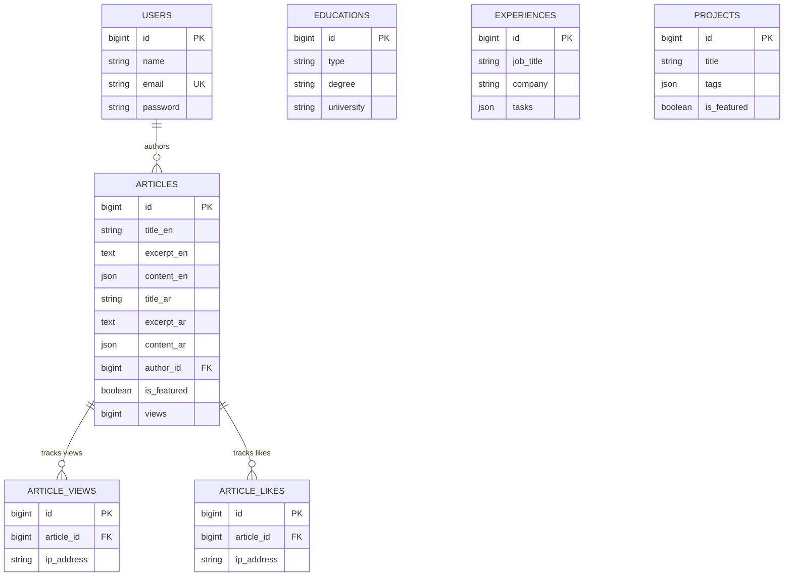

# Complete Technical & Architectural Documentation

**Project**: DevFolio Ultimate Portfolio System  
**Backend Framework**: Laravel 11 (PHP 8.2+)  
**Frontend Framework**: Next.js (TypeScript & React)  
**Author / Architect**: Principal Software Architect  
**Document Status**: Final Production Reference  

---

## 1. Project Overview

### What the Project Is
The **DevFolio Ultimate Portfolio System** is an enterprise-grade, full-stack personal portfolio and content management web application. It features a high-performance RESTful API backend engineered in Laravel 11 and a responsive client dashboard & public frontend built with Next.js and React.

### Business Goal
The primary objective of DevFolio is to provide developers, software engineers, and technical leaders with an authoritative, modern digital presence. It allows engineers to showcase their professional experience, academic qualifications, certified skills, open-source and commercial projects, technical articles/blogs with multi-language support (English and Arabic), CV downloads, contact channels, and social links through an intuitive admin dashboard and a sleek public web application.

### Target Users
1. **Public Visitors & Recruiters**: Potential employers, clients, and readers who browse featured projects, read bilingual technical articles, view career experience and qualifications, and initiate direct contact or download tailored CVs.
2. **System Administrator (Portfolio Owner)**: The authenticated user who manages all portfolio content, uploads project showcase media, publishes articles with syntax-highlighted code blocks, updates contact preferences, and monitors incoming inquiry messages.

### Main Modules
- **Authentication & Security**: Sanctum token-based admin authentication.
- **Profile & Landing Page Showcase**: Personal branding attributes, typewriter animations, terminal skills simulation, and quick bio links.
- **About Me & CV Management**: Dynamic bio management with multi-category CV uploads (General, Backend, QA).
- **Education & Qualifications**: Support for academic degrees, professional certifications, courses, bootcamps, internships, workshops, fellowships, and honors.
- **Career Experiences**: Professional employment history, job titles, company info, duration, and key achievement tasks.
- **Skill Groups**: Categorized tech stacks (Frontend, Backend, DevOps) with customized icon tags.
- **Projects Portfolio**: Showcase commercial and open-source projects with tags, GitHub code repositories, live demo URLs, and featured flags.
- **Articles & Technical Blog**: Rich content publication with bilingual translation binding (EN/AR), multi-file image/video attachments, code block execution representations, view tracking, and unique IP-based liking mechanisms.
- **Contact & Inquiry System**: Public visitor messaging, IP logging, and multi-channel admin contact settings (emails, phones, locations).
- **Social Links Management**: Aggregated links to developer platforms (GitHub, LinkedIn, Upwork, Fiverr, LeetCode, etc.).

### Overall Architecture
The application follows a decoupled **Client-Server Architecture** utilizing RESTful JSON communication over HTTP. 

```
┌─────────────────────────────────────────────────────────────┐
│                 Next.js Frontend Client                     │
│        (Public Site Pages & Admin Dashboard Views)          │
└──────────────────────────────┬──────────────────────────────┘
                               │ HTTP / HTTPS (JSON Payloads)
                               ▼
┌─────────────────────────────────────────────────────────────┐
│                 Laravel 11 RESTful API                      │
│ ┌──────────────────┐ ┌──────────────────┐ ┌───────────────┐ │
│ │  Sanctum Auth    │ │  Form Requests   │ │  Middlewares  │ │
│ └────────┬─────────┘ └────────┬─────────┘ └───────┬───────┘ │
│          │                    │                   │         │
│          ▼                    ▼                   ▼         │
│ ┌─────────────────────────────────────────────────────────┐ │
│ │                     Controllers                         │ │
│ └────────┬────────────────────┬───────────────────┬───────┘ │
│          │                    │                   │         │
│          ▼                    ▼                   ▼         │
│ ┌──────────────────┐ ┌──────────────────┐ ┌───────────────┐ │
│ │  Eloquent Models │ │ Spatie MediaLib  │ │ JsonResources │ │
│ └────────┬─────────┘ └────────┬─────────┘ └───────┬───────┘ │
│          │                    │                   │         │
│          ▼                    ▼                   ▼         │
│ ┌─────────────────────────────────────────────────────────┐ │
│ │           ApiResponse Trait & Uniform Handler           │ │
│ └─────────────────────────────┬───────────────────────────┘ │
└───────────────────────────────┼─────────────────────────────┘
                                │ SQL Queries / Storage Disk
                                ▼
┌─────────────────────────────────────────────────────────────┐
│                 MySQL Database & File Storage               │
└─────────────────────────────────────────────────────────────┘
```

---

## 2. Technology Stack

| Technology | Domain / Role | Why Chosen | Advantages | Alternatives |
| :--- | :--- | :--- | :--- | :--- |
| **Laravel 11** | Backend Framework | Rapid API development, expressive syntax, and robust built-in features for auth, routing, and ORM. | Elegant syntax, rich ecosystem, powerful database abstraction layer. | Symfony, NestJS, Django |
| **PHP 8.2+** | Runtime Environment | Required by Laravel 11; introduces typed properties, readonly classes, and JIT compilation. | High execution speed, strong type-safety features, universal hosting support. | Node.js, Python, Go |
| **MySQL 8.0** | Relational Database | Battle-tested relational engine with strong support for JSON columns and spatial indices. | ACID compliance, rock-solid stability, seamless integration with Eloquent. | PostgreSQL, SQLite |
| **Laravel Sanctum** | API Authentication | Lightweight token-based authentication system tailored for SPA and mobile clients. | Simple token creation and validation without JWT overhead. | Tymon JWT, OAuth2 Passport |
| **Eloquent ORM** | Data Mapper / Active Record | Native Laravel ORM for mapping database tables to PHP object models intuitively. | Expressive relationship definitions, eager loading, and query builder integration. | Doctrine, Cycle ORM |
| **Form Requests** | Request Validation | Isolated request validation logic encapsulated in dedicated classes. | Keeps controllers lean and guarantees clean validated input arrays. | Inline controller validation |
| **API Resources** | JSON Serialization | Transformation layer between database models and API responses. | Prevents model data leaks and formats exact output arrays for clients. | Raw array casting, Fractal |
| **Spatie Media Library** | Attachment Management | Handles file uploads, media collections, and disk associations effortlessly. | Automatically associates files with Eloquent models across multiple disks. | Custom file upload scripts |
| **Localization (`__('messages')`)** | Internationalization | Manages multilingual API strings dynamically based on request locale headers. | Clean separation of message text from backend business logic. | Hardcoded string literals |
| **ApiResponse Trait** | API Standardization | Unified helper trait providing consistent JSON structures across all responses. | Enforces strict response signatures (`success`, `message`, `data`, `meta`). | Duplicate response code |
| **Vite / Next.js** | Frontend Application | SSR/SSG framework for React producing modern, SEO-friendly portfolio interfaces. | Instant page rendering, optimal asset optimization, and superb Developer Experience (DX). | Pure React SPA, Vue/Nuxt |

---

## 3. Folder Structure

The repository maintains an organized directory layout adhering strictly to Laravel architecture conventions:

```
Devfolio-Array/
├── app/
│   ├── Http/
│   │   ├── Controllers/        # Controllers handling HTTP requests & business workflows
│   │   │   └── Api/            # Specialized composite controllers (Home, Landing)
│   │   ├── Requests/           # FormRequest classes isolating validation rules
│   │   └── Resources/          # JsonResource classes for model-to-JSON transformation
│   ├── Models/                 # Eloquent ORM models representing database tables
│   ├── Providers/              # Framework service providers bootstrapping app components
│   └── Traits/                 # Shared traits including ApiResponse trait for standardization
├── bootstrap/                  # Framework initialization and exception handler setup (`app.php`)
├── config/                     # Application configuration files (sanctum, media-library, etc.)
├── database/
│   ├── factories/              # Model factories for automated testing data generation
│   ├── migrations/             # Database migration files defining schema structure
│   └── seeders/                # Database seeders populating initial environments
├── lang/
│   └── en/
│       └── messages.php        # Centralized English translation strings for API responses
├── public/                     # Public web root directory (`index.php`, uploaded media storage symlinks)
├── resources/                  # Raw views, CSS, JavaScript, and asset sources
├── routes/
│   ├── api.php                 # RESTful API route definitions (Public & Sanctum protected)
│   ├── console.php             # Artisan CLI command registrations
│   └── web.php                 # Fallback web routes
├── storage/                    # Uploaded media files, application logs, and framework cache
└── tests/                      # Automated Feature and Unit test suites
```

---

## 4. Database Design

### Database Tables & Column Specifications

1. **`users`**: Stores authenticated administrator credentials.
   - `id` (BIGINT, Primary Key, Auto Increment)
   - `name` (VARCHAR 255)
   - `email` (VARCHAR 255, Unique Index)
   - `password` (VARCHAR 255, Hashed)
   - `remember_token` (VARCHAR 100, Nullable)
   - `created_at`, `updated_at` (TIMESTAMP)

2. **`about_me`**: Stores personal biography summary and media link identifiers.
   - `id` (BIGINT, Primary Key, Auto Increment)
   - `title` (VARCHAR 255)
   - `description` (TEXT)
   - `created_at`, `updated_at` (TIMESTAMP)

3. **`educations`**: Stores academic and professional qualification records.
   - `id` (BIGINT, Primary Key, Auto Increment)
   - `type` (VARCHAR 100, Default: `'Education'`)
   - `degree` (VARCHAR 255)
   - `university` (VARCHAR 255, Nullable)
   - `location` (VARCHAR 255, Nullable)
   - `duration` (VARCHAR 255, Nullable)
   - `grade` (VARCHAR 50, Nullable)
   - `description` (TEXT, Nullable)
   - `created_at`, `updated_at` (TIMESTAMP)

4. **`experiences`**: Stores employment history and career positions.
   - `id` (BIGINT, Primary Key, Auto Increment)
   - `job_title` (VARCHAR 255)
   - `company` (VARCHAR 255, Nullable)
   - `location` (VARCHAR 255, Nullable)
   - `duration` (VARCHAR 255)
   - `tasks` (JSON, Stores array of position responsibility strings)
   - `created_at`, `updated_at` (TIMESTAMP)

5. **`skill_groups`**: Stores skill stack categories.
   - `id` (BIGINT, Primary Key, Auto Increment)
   - `title` (VARCHAR 255)
   - `icon` (VARCHAR 255, Nullable)
   - `skills` (JSON, Stores array of skill tag strings)
   - `created_at`, `updated_at` (TIMESTAMP)

6. **`projects`**: Stores commercial and showcase software applications.
   - `id` (BIGINT, Primary Key, Auto Increment)
   - `title` (VARCHAR 255)
   - `description` (TEXT)
   - `github_link` (VARCHAR 255, Nullable)
   - `demo_link` (VARCHAR 255, Nullable)
   - `tags` (JSON, Array of tech stack tags)
   - `is_featured` (BOOLEAN, Default: `false`)
   - `created_at`, `updated_at` (TIMESTAMP)

7. **`articles`**: Stores published bilingual blogs and deep-dive technical articles.
   - `id` (BIGINT, Primary Key, Auto Increment)
   - `title_en` (VARCHAR 255), `excerpt_en` (TEXT), `content_en` (JSON)
   - `title_ar` (VARCHAR 255, Nullable), `excerpt_ar` (TEXT, Nullable), `content_ar` (JSON, Nullable)
   - `feature_image` (VARCHAR 255, Nullable), `feature_video` (VARCHAR 255, Nullable)
   - `tags` (JSON, Array of strings)
   - `author_id` (BIGINT, Foreign Key referencing `users.id`)
   - `views` (BIGINT, Default: 0)
   - `is_featured` (BOOLEAN, Default: `false`)
   - `created_at`, `updated_at` (TIMESTAMP)

8. **`article_views`** & **`article_likes`**: Tracks engagement analytics by IP address.
   - `id` (BIGINT, Primary Key)
   - `article_id` (BIGINT, Foreign Key referencing `articles.id` ON DELETE CASCADE)
   - `ip_address` (VARCHAR 45)
   - `created_at`, `updated_at` (TIMESTAMP)

9. **`contact_messages`** & **`contact_settings`**: Stores public visitor inquiry messages and admin channels.

10. **`cvs`**: Stores downloadable resume documents.

---

### Entity Relationship Diagram (ERD)



---

## 5. Models Breakdown

Every model encapsulates business attributes, database casting rules, and media associations:

- **`User`** (`app/Models/User.php`):
  - *Casts*: `'password' => 'hashed'`.
  - *Relationships*: `articles()` -> `HasMany(Article::class, 'author_id')`.
  - *Traits*: `HasApiTokens`, `HasFactory`, `Notifiable`.

- **`Article`** (`app/Models/Article.php`):
  - *Casts*: `'content_en' => 'array'`, `'content_ar' => 'array'`, `'tags' => 'array'`, `'is_featured' => 'boolean'`.
  - *Relationships*: `author()` -> `BelongsTo(User::class, 'author_id')`, `likesRelation()` -> `HasMany(ArticleLike::class, 'article_id')`.

- **`Experiences`** (`app/Models/Experiences.php`):
  - *Casts*: `'tasks' => 'array'`. Converts position responsibility lists automatically between JSON database fields and native PHP arrays.

- **`SkillGroups`** (`app/Models/SkillGroups.php`):
  - *Casts*: `'skills' => 'array'`. Serves tech stack groups to the dashboard and homepage skills terminal.

- **`Project`** (`app/Models/Project.php`):
  - *Casts*: `'tags' => 'array'`, `'is_featured' => 'boolean'`. Interacts with Spatie Media Library under collection `'project_images'`.

---

## 6. Authentication System

Authentication uses **Laravel Sanctum** to issue secure HTTP bearer tokens.

```
┌──────────────┐          1. POST /api/login (email, password)         ┌──────────────┐
│  Next.js Admin│ ────────────────────────────────────────────────────> │ Laravel API  │
│  Dashboard   │ <──────────────────────────────────────────────────── │ (Sanctum)    │
└──────────────┘          2. HTTP 200 JSON (token, user object)        └──────────────┘
       │                                                                      │
       │                  3. Subsequent Admin Request                         │
       │                     Header: Authorization: Bearer <token>            │
       └──────────────────────────────────────────────────────────────────────┘
```

- **Login Workflow (`AuthController@login`)**: Validates email and password credentials using `Hash::check()`. Revokes existing active user tokens via `$user->tokens()->delete()` and issues a fresh plain text token via `$user->createToken('auth_token')->plainTextToken`.
- **Protected Routes Group**: Guarded by `auth:sanctum` middleware inside `routes/api.php`. Rejects invalid or missing tokens with HTTP 401 (`Unauthenticated.`).

---

## 7. API Endpoint Reference

Every API response adheres strictly to the unified architecture: `{ "success": boolean, "message": string, "data": object|array, "meta": object|null }`.

### Public Endpoints

#### `GET /api/portfolio-data`
- **Controller**: `Api\AboutMeLandingPageController@index`
- **Summary**: Compiles complete public portfolio datasets in a single HTTP request for landing page hydration.
- **Success Response (HTTP 200)**:
```json
{
  "success": true,
  "message": "Landing page data retrieved successfully.",
  "data": {
    "about": { "id": 1, "title": "Senior Backend Architect", "description": "..." },
    "skills": [ { "id": 1, "title": "Backend", "skills": ["Laravel", "Node.js"] } ],
    "experience": [ { "id": 1, "job_title": "Lead Software Engineer" } ],
    "education": [ { "id": 1, "type": "Education", "degree": "B.Sc. Computer Science" } ],
    "cvs": [ { "id": 1, "title": "General Resume", "file_url": "http://..." } ]
  }
}
```

#### `GET /api/articles`
- **Controller**: `ArticleController@index`
- **Params**: `page` (int, default: 1), `per_page` (int, default: 5, max: 50).
- **Headers**: `Accept-Language: en|ar` (dynamically resolves bilingual content).
- **Success Response (HTTP 200)**:
```json
{
  "success": true,
  "message": "Articles retrieved successfully.",
  "data": {
    "data": [ { "id": 1, "title": "Building Scalable Systems", "stats": { "views": 120, "likes": 15, "liked": false } } ],
    "current_page": 1,
    "last_page": 3,
    "per_page": 5,
    "total": 14
  },
  "meta": { "current_page": 1, "last_page": 3, "per_page": 5, "total": 14 }
}
```

---

## 8. Controllers Architecture

All application controllers extend `App\Http\Controllers\Controller` and leverage `App\Traits\ApiResponse` to format outputs uniformely.

```php
namespace App\Http\Controllers;

use App\Http\Requests\EducationRequest;
use App\Http\Resources\EducationResource;
use App\Models\Education;
use App\Traits\ApiResponse;

class EducationController extends Controller
{
    use ApiResponse;

    public function index()
    {
        $educations = Education::latest()->paginate(10);
        return $this->paginatedResponse(
            EducationResource::collection($educations),
            __('messages.education_history_retrieved'),
            200
        );
    }
}
```

---

## 9. Form Requests & Validation

Input validation rules are isolated in dedicated `FormRequest` classes inside `app/Http/Requests`:

```php
namespace App\Http\Requests;

use Illuminate\Foundation\Http\FormRequest;

class ExperienceRequest extends FormRequest
{
    public function authorize(): bool { return true; }

    public function rules(): array
    {
        return [
            'job_title' => 'required|string|max:255',
            'company'   => 'nullable|string|max:255',
            'location'  => 'nullable|string|max:255',
            'duration'  => 'required|string|max:255',
            'tasks'     => 'nullable|array|min:1',
            'tasks.*'   => 'nullable|string',
        ];
    }
}
```

---

## 10. API JsonResources

Transformation resources inside `app/Http/Resources` filter output properties and format media URLs:

```php
namespace App\Http\Resources;

use Illuminate\Http\Request;
use Illuminate\Http\Resources\Json\JsonResource;

class ProjectResource extends JsonResource
{
    public function toArray(Request $request): array
    {
        return [
            'id'          => $this->id,
            'title'       => $this->title,
            'description' => $this->description,
            'github_link' => $this->github_link,
            'demo_link'   => $this->demo_link,
            'tags'        => $this->tags ?? [],
            'image_url'   => $this->getFirstMediaUrl('project_images'),
            'is_featured' => (bool)$this->is_featured,
            'created_at'  => $this->created_at ? $this->created_at->format('Y-m-d') : null,
        ];
    }
}
```

---

## 11. Exception Handling Architecture

Global API exception handling is configured in `bootstrap/app.php` to intercept all framework exceptions and force JSON responses:

```php
->withExceptions(function (Exceptions $exceptions): void {
    $exceptions->render(function (\Illuminate\Validation\ValidationException $e, $request) {
        if ($request->is('api/*') || $request->wantsJson()) {
            return response()->json([
                'success' => false,
                'message' => __('messages.validation_failed'),
                'errors'  => $e->errors(),
            ], 422);
        }
    });
    // Additional handlers for 401, 403, 404, 405, and 500
})
```

---

## 12. Security & Performance Practices

1. **Mass Assignment Protection**: All models explicitly list editable attributes in `$fillable`.
2. **SQL Injection Prevention**: Queries utilize Eloquent PDO parameter binding exclusively.
3. **Optimized Eager Loading**: Complex queries pre-load relations (`Article::with(['author'])`) and count relationships efficiently (`withCount`, `withExists`) to prevent N+1 performance bottlenecks.
4. **XSS & File Validation**: Strict MIME type checks (`mimes:pdf,jpg,png,webp`) and server-side file verification prevent malicious executable uploads.

---

## 13. How to Add a New Feature (Developer Guide)

To add a new module (e.g., **Testimonials**):
1. **Create Database Migration & Model**:
   `php artisan make:model Testimonial -m`
2. **Define Validation Rules**:
   `php artisan make:request TestimonialRequest`
3. **Create Transformation Resource**:
   `php artisan make:resource TestimonialResource`
4. **Build Controller using `ApiResponse` Trait**:
   Implement CRUD actions returning `$this->successResponse()` or `$this->paginatedResponse()`.
5. **Register Localization Strings**:
   Add translation keys inside `lang/en/messages.php`.
6. **Register API Routes**:
   Add endpoint declarations inside `routes/api.php`.

---

## 14. Technical Glossary

- **RESTful API**: Representational State Transfer architectural style for HTTP web services.
- **Sanctum**: Lightweight authentication system for issuing bearer tokens to clients.
- **FormRequest**: Dedicated validation class isolating incoming HTTP validation rules.
- **JsonResource**: Layer converting Eloquent models into formatted JSON structures.
- **Eager Loading**: Query technique pre-loading related database models to prevent N+1 queries.
- **Middleware**: Code pipeline inspecting and filtering incoming HTTP requests before reaching controllers.
